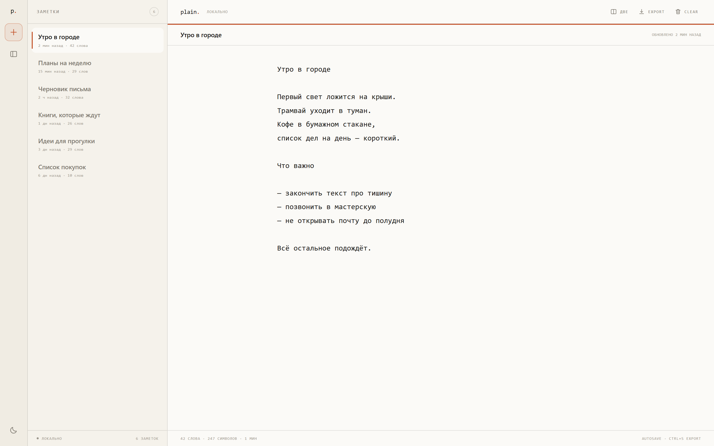
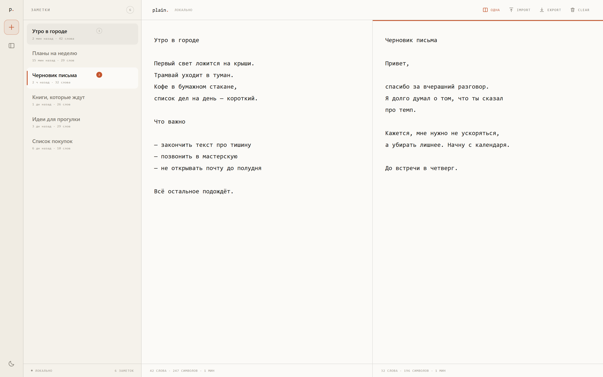
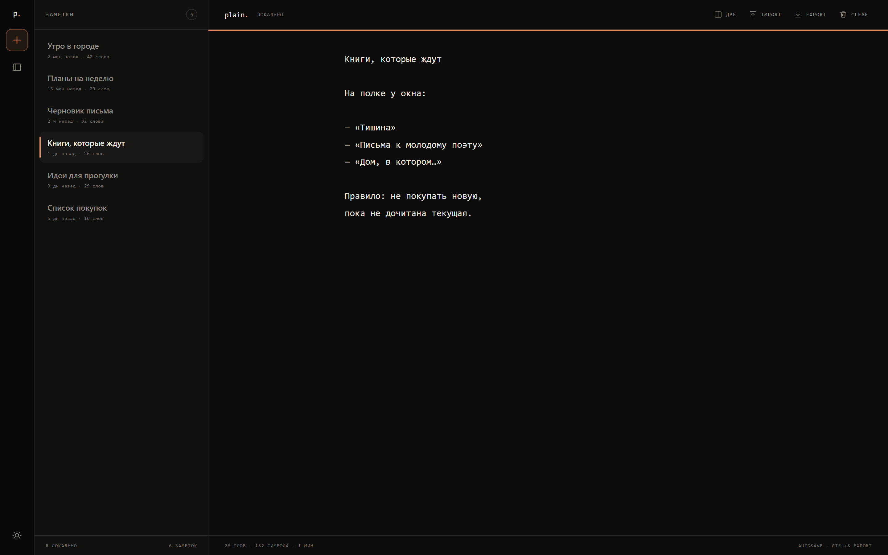
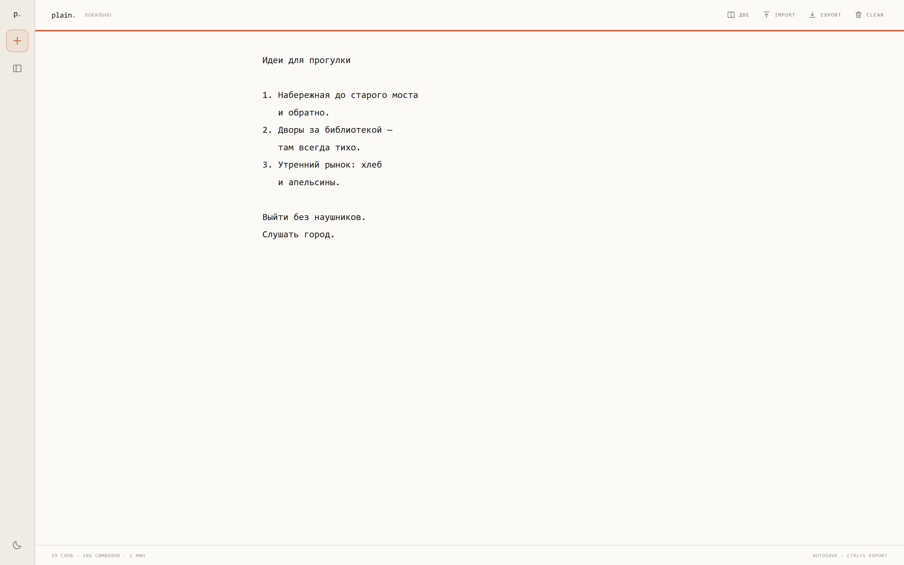
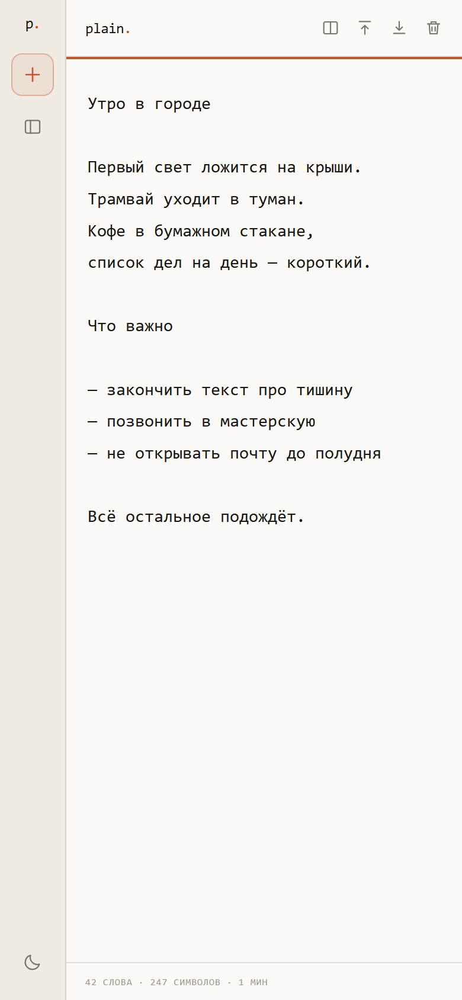
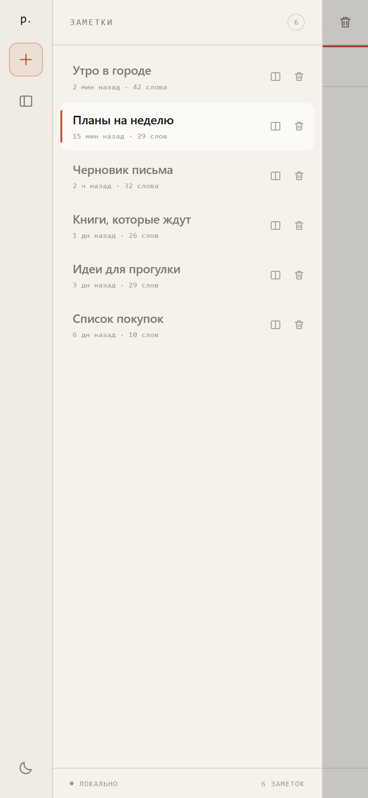

<div align="center">

# plain.

### Тихий блокнот с двумя половинами

Несколько заметок. Одна тихая страница. Автосохранение.<br>
Rust · WebAssembly · без облака и аккаунтов.

[](https://www.rust-lang.org/)
[](https://webassembly.org/)
[](https://trunkrs.dev/)
[](LICENSE)
[](https://d1m40fficial.github.io/notes/)

[Возможности](#возможности) · [Скриншоты](#скриншоты) · [Запуск](#запуск) · [Архитектура](#архитектура) · [Клавиши](#клавиши)



<sub>Светлая тема · список заметок · редактор</sub>

</div>

---

> **plain** — переосмысление [одноимённого блокнота](https://github.com/d1m40fficial/notes) на Rust.<br>
> Та же бумажная типографика и тот же принцип «текст важнее интерфейса», но теперь можно
> держать несколько заметок, убирать список с глаз и открывать две записи рядом.

## Возможности

| Кнопка | Возможность |
| :---: | :--- |
| **+** | **Новая заметка у левого края.** Кнопка в рейле всегда под рукой — даже когда список скрыт. На телефоне рейл остаётся на месте. |
| **▤** | **Скрываемый список.** Панель заметок сворачивается в ноль одной кнопкой или через `Ctrl/Cmd+\`. На узких экранах она становится overlay-панелью и закрывается по `Esc`, клику мимо или выбору заметки. |
| **◫** | **Две заметки одновременно.** Split-view делит экран на две независимые половины. Активная панель отмечена акцентной линией и номером; вторая открывается кнопкой в шапке, горячей клавишей или иконкой у заметки. |
| **◐** | **Светлая и тёмная темы.** Выбор запоминается. Системный моноширинный шрифт, тонкие линейки, никаких теней и градиентов. |
| **↻** | **Автосохранение.** Текст пишется в `localStorage` через 240 мс после ввода и синхронно — при закрытии страницы. |
| **↓** | **Экспорт и очистка.** Активная заметка скачивается как `.md` по `Ctrl/Cmd+S`; очистка — с подтверждением. |
| **⌨** | **Мелочи, которые важны.** `Tab` вставляет два пробела, счётчик слов и времени чтения обновляется на лету, старая единственная заметка из `plain.note.v1` переносится автоматически. |

## Скриншоты

### Две заметки рядом

Каждая половина — самостоятельный редактор со своим текстом, счётчиками и автосохранением.



### Тёмная тема



### Режим фокуса

Список скрыт, остаются только заметка и узкий рейл с кнопкой «+».



### Мобильный вид

<p align="center">
  
  
</p>

<p align="center"><sub>Редактор и overlay-список на экране 390 px</sub></p>

## Запуск

Живая версия: [**d1m40fficial.github.io/notes**](https://d1m40fficial.github.io/notes/).

Нужны [Rust](https://rustup.rs/) (stable) и [Trunk](https://trunkrs.dev/).

```bash
rustup target add wasm32-unknown-unknown
cargo install trunk --locked

trunk serve
```

Откройте `http://127.0.0.1:5184/`. Для production-сборки:

```bash
trunk build --release
# dist/ — готовые index.html, styles.css, plain.js и plain_bg.wasm
```

Release-бандл — примерно **160 КБ WebAssembly** и **29 КБ JS-glue**.

<details>
<summary><b>Windows без MSVC Build Tools</b></summary>

Если установлен Rust-тулчейн MSVC, но нет `link.exe`, host-сборка упадёт на build-скриптах. Проект проверялся с GNU-тулчейном и встроенным `rust-lld`. Сам Trunk проще взять готовым бинарником из [releases](https://github.com/trunk-rs/trunk/releases) — собирать его без MSVC тоже не получится.

```powershell
rustup toolchain install stable-x86_64-pc-windows-gnu --profile minimal
rustup target add --toolchain stable-x86_64-pc-windows-gnu wasm32-unknown-unknown

$env:RUSTUP_TOOLCHAIN = "stable-x86_64-pc-windows-gnu"
$env:PATH = "$env:USERPROFILE\.rustup\toolchains\stable-x86_64-pc-windows-gnu\bin;$env:PATH"

trunk serve
```

`.cargo/config.toml` уже содержит `linker = "rust-lld"` для GNU-target. Обычная MSVC-сборка этот файл не затрагивает.

</details>

<details>
<summary><b>GitHub Pages</b></summary>

Соберите с базовым путём репозитория и опубликуйте `dist/`:

```powershell
trunk build --release --public-url /notes/
```

Если Pages настроен на папку `docs`, скопируйте туда содержимое `dist` после сборки.

</details>

## Архитектура

Никакого виртуального DOM и JS-фреймворка: разметка строится напрямую через `web-sys`,
состояние живёт в одном `App`, а изменения сохраняются через `serde_json`.

```
            index.html
                │  Trunk
                ▼
     plain.js + plain_bg.wasm
                │
       ┌────────┴────────┐
       ▼                 ▼
   src/app.rs        src/model.rs
   DOM · events      Note · Session
   split-view        normalize
       │                 │
       ▼                 ▼
    web-sys           serde_json
       │                 │
       └────────┬────────┘
                ▼
          localStorage
```

| Файл | Назначение |
| --- | --- |
| `src/lib.rs` | точка входа wasm и монтирование приложения |
| `src/app.rs` | состояние, DOM, обработчики, split-view |
| `src/model.rs` | `Note`, `Session`, `Theme`, нормализация состояния |
| `src/storage.rs` | чтение/запись `localStorage`, миграция старой заметки |
| `src/util.rs` | время, русские склонения, slug для экспорта, UTF-16-смещения |
| `src/icons.rs` | встроенные SVG-иконки |
| `styles.css` | вёрстка, темы, адаптивность |
| `index.html` | HTML-вход Trunk |

## Клавиши

| Действие | Сочетание |
| --- | --- |
| Новая заметка | кнопка **+** в рейле или `Ctrl/Cmd+Alt+N` |
| Скрыть/показать список | кнопка **▤** или `Ctrl/Cmd+\` |
| Открыть/закрыть split-view | кнопка **◫**, `Ctrl/Cmd+Alt+2` или иконка **◫** у заметки |
| Перейти в другую половину | клик по её редактору |
| Экспорт активной заметки | `Ctrl/Cmd+S` |
| Два пробела вместо Tab | `Tab` в редакторе |
| Закрыть список на телефоне | `Esc`, клик по scrim или выбор заметки |

Название заметки берётся из первой непустой строки. Отдельного поля заголовка нет:
заметка остаётся простым текстом, как в оригинале.

## Данные и приватность

Текст не покидает браузер. Нет аналитики, запросов, аккаунтов и синхронизации.

| Ключ | Что хранит |
| --- | --- |
| `plain.state.v2` | массив заметок и состояние интерфейса |
| `plain.theme.v1` | выбранная тема |
| `plain.note.v1` | старая единственная заметка; переносится при первом запуске и удаляется |

Формат `plain.state.v2`:

```json
{
  "notes": [
    {
      "id": "n...",
      "body": "Утро в городе\n\nПервый свет...",
      "createdAt": 1790000000000,
      "updatedAt": 1790000000000
    }
  ],
  "session": {
    "active": "n...",
    "secondary": null,
    "split": false,
    "sidebar": true,
    "activePane": 0
  }
}
```

Если `localStorage` недоступен, приложение продолжает работать в памяти и показывает
«без сохранения» или «ошибка» вместо статуса.

## Проверено

- создание, переключение, удаление и очистка заметок;
- автосохранение и восстановление после перезагрузки;
- скрытие списка: нулевая ширина, `inert`, возврат фокуса;
- split-view: независимые редакторы, активная половина, закрытие с сохранением левой заметки;
- мобильный overlay-список и вертикальный split;
- отсутствие горизонтального переполнения на 360–1440 px;
- миграция `plain.note.v1` и старой темы;
- экспорт `.md` с корректным именем файла;
- отсутствие ошибок в консоли.

## Лицензия

MIT. Основано на **plain** © 2026 [d1m40fficial](https://github.com/d1m40fficial/notes).<br>
Текст лицензии — в `LICENSE`.
